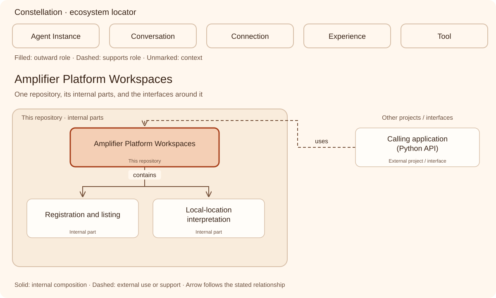

# Workspace registration metadata

`amplifier_workspace_metadata` owns registration edits, native observation
reconciliation, local-location interpretation, and list/search/paging over
caller-owned records. It uses only
Python's standard library. It does not import Unified, Core or Foundation, read
folders, allocate identities, persist state, or authorize access.

The public exports are `register`, `edit`, `reconcile`, `listing`,
`RegistrationReconciliation`, `local_location`, and `LocalLocation`.
Callers supply the current mutable registration
list. Edits preserve existing row objects and custom fields. Reconciliation
returns ordered reference remaps for the caller to apply under its existing
lock. `listing(registrations, args)` returns shallow row copies with the current
query, label and paging rules; nested custom values retain their references.
The caller validates action inputs and resolved folders, and owns transactions,
selection, pins, Canvas effects, history and publication.

Current path-derived IDs, unresolved native-project placeholders and display
aliases retain their meanings. This package does not implement multi-location
bindings, portable identity, shared context, filesystem grants or a second chat
catalog. Those remain separate workspace and conversation-owner contracts.

## Ecosystem map

[Project overview](https://microsoft.github.io/amplifier-constellation/projects/amplifier-platform-workspaces/) ·
[Open the map](https://github.com/bkrabach/amplifier-platform-workspaces/blob/main/docs/ecosystem-map.svg) ·
[Map guide](https://github.com/microsoft/amplifier-constellation/blob/main/docs/ecosystem-maps.md)



<details>
<summary>The wider Constellation ecosystem</summary>


</details>

These maps are generated from the [canonical registry](https://github.com/microsoft/amplifier-constellation/blob/main/docs/ecosystem/registry.json).
Update that source and refresh the local maps together; a map is not a release or compatibility claim.

## Interpret a legacy local location

`local_location(registration)` returns an immutable
`LocalLocation(workspace_id, path, available)` snapshot, or `None` when the
legacy path is missing, `None` or empty. It preserves the existing ID and exact
path spelling without resolving folders, normalizing paths or probing availability.
A nonempty path with `available=False` remains a known location; missing or
`None` availability remains unknown. The recorded availability is not coerced.

The observation is local to the caller's existing installation/account scope.
It is not a location identity, native history locator or permission grant.
The existing registration's top-level `path` remains the sole writable location;
the snapshot is derived, never a second persisted record. Call again after a
registration changes. Custom fields, including any existing `locations` field,
remain opaque and untouched. Archive and display-name edits do not erase the
location. Unresolved native-project placeholders still follow the existing
ordered reconciliation/remap rules.

This API adds interpretation only. It does not change host ID derivation,
discovery, selection, pins, settings, sessions, Canvas, execution directories or
history. Interpreting a changed path does not move files or running work.

## Develop and qualify

Use Python 3.13 or newer and `uv`. From this directory:

```sh
uv run --extra test pytest
uv build
```

The build uses ordinary isolated setuptools dependencies; no application install
is needed. To check the installed wheel outside this source directory, use a
separate temporary directory and environment:

```sh
check_dir=$(mktemp -d)
uv venv --python 3.13 "$check_dir/venv"
uv pip install --python "$check_dir/venv/bin/python" \
  ./dist/amplifier_workspace_metadata-0.2.0-py3-none-any.whl 'pytest>=8'
cp -R tests "$check_dir/tests"
(cd "$check_dir" && ./venv/bin/python -I -m pytest tests)
"$check_dir/venv/bin/python" -I -c \
  'import amplifier_workspace_metadata as m; print(m.__file__)'
```

Confirm the import resolves inside that environment and Unified/Core/Foundation
are absent. The source distribution includes the same direct tests. Host action,
native history and shell integration tests remain in Unified; standalone checks
do not establish those promises or untested platform/interpreter support.

## Ownership and delivery

This history-preserving project is prepared as the public standalone author home
at `bkrabach/amplifier-platform-workspaces`, with a later transfer to Microsoft
planned. [PROVENANCE.json](PROVENANCE.json) maps the original Unified commits,
including the source and tests before their component move. The MIT attribution,
`amplifier-workspace-metadata` distribution, `amplifier_workspace_metadata` import, runtime bytes,
and standalone test behavior are unchanged by this handoff.

This package covers registration metadata, not the full workspace domain.
Filesystem access, identity allocation, persistence, selection, authorization,
native history and host integration remain with their existing owners. The
separate `amplifier-workspace` developer CLI is not replaced or renamed.

Use a separate environment for this standalone distribution. Do not coinstall it
with `amplifier-unified`: Unified currently owns its selected installed package
files. Source hosting and author changes do not alter that selection. After the
reviewed authoring handoff, do not maintain competing authored copies.

## Existing artifacts and qualification

Unified selects the original published 0.2.0 artifact from
[its immutable workspace-metadata-v0.2.0 release](https://github.com/microsoft/amplifier-unified/releases/tag/workspace-metadata-v0.2.0).
Its source receipt retains the original producer identity. This repository does
not republish or overwrite those bytes. Unified continues to verify its generated
selection offline for wheel, source-archive and editable builds; no sibling
checkout or this repository is required by that packaged selection.

The **Workspace metadata package** workflow builds one wheel and source archive,
then runs the existing tests against that installed wheel outside this checkout
on Linux/Python 3.13. It uploads qualification artifacts only. Native Windows,
macOS and host integration acceptance remain separate; source publication is not
proof of installed substitution or a live deployment.

The imported version remains 0.2.0. Before a new publication, coordinate
its version and exact source/artifact receipt with consumers. Unified's later
selection is an explicit reviewed change with a sole installed owner and ordinary
rollback. Newer records, uncertain effects and caller-owned state retain their
authority; neither source handoff nor rollback permits replay. A later repository
transfer should preserve history and releases.

## Contributing

> [!NOTE]
> This project is not currently accepting external contributions, but we're actively working toward opening this up. We value community input and look forward to collaborating in the future. For now, feel free to fork and experiment!

Most contributions require you to agree to a
Contributor License Agreement (CLA) declaring that you have the right to, and actually do, grant us
the rights to use your contribution. For details, visit [Contributor License Agreements](https://cla.opensource.microsoft.com).

The Microsoft source contribution requirements remain applicable to changes
intended for transfer upstream. The temporary personal repository does not claim
that a Microsoft CLA bot or other organization automation is already configured.

This project has adopted the [Microsoft Open Source Code of Conduct](https://opensource.microsoft.com/codeofconduct/).
For more information see the [Code of Conduct FAQ](https://opensource.microsoft.com/codeofconduct/faq/) or
contact [opencode@microsoft.com](mailto:opencode@microsoft.com) with any additional questions or comments.

## Trademarks

This project may contain trademarks or logos for projects, products, or services. Authorized use of Microsoft
trademarks or logos is subject to and must follow
[Microsoft's Trademark & Brand Guidelines](https://www.microsoft.com/legal/intellectualproperty/trademarks/usage/general).
Use of Microsoft trademarks or logos in modified versions of this project must not cause confusion or imply Microsoft sponsorship.
Any use of third-party trademarks or logos are subject to those third-party's policies.
